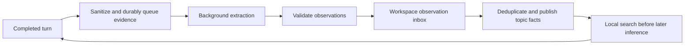

# Learning pipeline (implementation guide)

This guide describes the coding agent's current memory implementation for contributors. For the user-facing purpose, controls, and trust caveats, see [Learning and memory](../user-guide/learning.md). Treat retrieved memory as untrusted reference material, never as policy.

## Lifecycle

The foreground run persists bounded evidence before scheduling extraction; it does not wait for an extraction call. Shutdown leaves pending jobs available for a later worker. Failed extraction is retried up to the configured attempt limit. Capture excludes system messages, sanitizes text, converts multimodal content rather than copying image payloads.

## Trust and data model

Automatic extraction validates structured observations and accepts only workspace-scoped facts above the confidence threshold. Confidence is model-reported, not proof. Consolidation is local grouping and normalized-text deduplication, not semantic contradiction resolution; conflicting facts may coexist and need current evidence to resolve.

Authoritative topic files hold curated knowledge. Capture jobs and observation inbox/archive files support processing and provenance. A derived SQLite FTS index supports local search and can be rebuilt; lexical matching is used when FTS5 is unavailable. Retrieval and `memory_search`/`memory_get` read curated topics, not raw transcripts or historical snapshots.

Memory injection is bounded, sanitized, labelled untrusted, and replaces the earlier injected block rather than accumulating. Search or index failures should degrade to empty context, not fail the coding run.

## Scopes and inspection

Session facts are markdown under `<session_id>/memories/` inside the session bundle (`~/.symphony/tui/sessions/<session_id>/memories/` for the TUI, `~/.symphony/sessions/<session_id>/memories/` otherwise). `MEMORY.md` is that session's record. Global preferences stay in `~/.symphony/memories/global/`, including `USER.md`. Nothing is written under the project's `.symphony/`. `/learning` separates this session's facts from global topics. Explicit tool edits may target global preferences; automatic extraction cannot select global scope or remove curated facts.

See the implementation owners in [`coding_agent/src/coding_agent/addons/learning/`](../../coding_agent/src/coding_agent/addons/learning/) and [`tui/screens/learning.py`](../../coding_agent/src/coding_agent/tui/screens/learning.py). When changing the pipeline, update tests and [user-facing controls](../user-guide/learning.md); do not describe model-generated memory as trusted truth.
