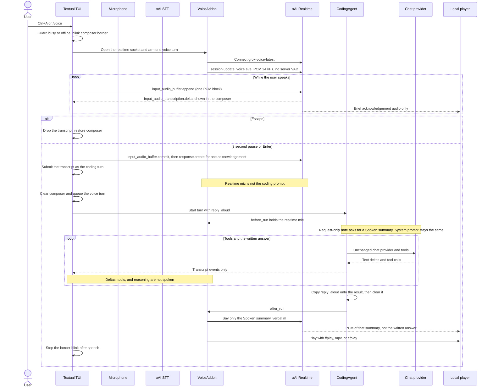

# Voice mode: capture, agent execution, and speech

Voice mode is an optional Symphony TUI feature, entered with **Ctrl+A** or
`/voice`. It does not change the coding model. Listening is one realtime
socket: mic audio goes up as the user speaks, transcript deltas come back
immediately, and the utterance is committed after a 3 second pause or Enter.
That one socket speaks both lines: a short acknowledgement when the
utterance is committed, and later only the spoken summary. The written
answer stays in the chat and is not dictated. There is no separate TTS or
STT connection on this path.

## Call and protocol map

### External calls

| Purpose | Endpoint / transport | Request and response |
| --- | --- | --- |
| Transcription | `POST https://api.x.ai/v1/stt`, HTTPS multipart | `model=grok-voice-transcribe-2.0`, `language=en`, WAV `file`; JSON `text`. Model fields precede file. 30s timeout. |
| Realtime audio | `wss://api.x.ai/v1/realtime?model=grok-voice-latest`, WebSocket JSON | `session.update` (no server VAD), base64 `input_audio_buffer.append`, then `input_audio_buffer.commit` and `response.create` after 3 s of quiet or Enter. Transcript deltas update the composer. The created response is one spoken acknowledgement. |
| Spoken summary | Same realtime socket | `conversation.item.create` with the summary text, then `response.create` telling the model to say that sentence only. PCM comes back on the socket already open. The chat answer is not this audio. |
| Coding model | Existing configured provider protocol | Unchanged: provider-specific streaming request, tools, approvals, persistence, and final response. |

All xAI audio connections use a Bearer token: `XAI_API_KEY` takes precedence;
otherwise `grok_voice_credentials()` uses the stored Grok device-login token
and its extra headers. They target `api.x.ai`, not the CLI chat proxy. Actual
account access and API compatibility must be checked with a live smoke test;
unit tests mock the provider and do not prove entitlement.

## When does output get spoken?

A voice question sets `CoreHarness.reply_aloud` for the run that is about to
start. `run_session` copies that flag onto `HarnessResult.reply_aloud` and
clears it, so the next typed turn stays silent. For that run only, the per-turn request context asks the model to finish its
normal answer with a `## Spoken summary` section. The system prompt is not
changed, so the provider prefix cache still matches. The note is not persisted
and does not add a model call.
`VoiceAddon.after_run` speaks that section (fences stripped, length capped).
If the model omits it, nothing is spoken. The whole answer is never dictated. The
section is stripped before the answer is shown or saved, including while the
heading is still streaming, so the chat never displays it. Streamed deltas,
tool output, and reasoning are not dictated. There is no canned
"working on it" sentence.

The acknowledgement and the summary are both PCM from the same socket.
Playback writes one WAV when that response finishes, so the first sound is
not the first visible token.

The voice addon stays registered but is armed for one voice turn only. Later
typed turns and child harnesses stay silent. Cancellation/quit closes voice
resources; failed runs must also clear the voice indicator. The composer and approval
choices remain visible and actionable throughout voice activity. Its existing
rounded border alternates light purple (`#D7C4FB`) and dark purple (`#A371F7`)
every 0.5 seconds; removing the voice classes restores the theme/focus border.
There is no separate voice bar and no composer hide/show transition.

## Owners and limits

- `tui/composer/voice.py`: credentials, the test-only WAV recorder and REST
  STT client, border colors, and the spoken-summary splitter.
- `tui/composer/voice_mode.py`: user entry, live transcript, commit on pause
  or Enter, and UI recovery.
- `addons/voice/addon.py`: per-run opt-in. Speaks the summary on the realtime
  socket and never opens TTS.
- `addons/voice/stream.py`: the one speech-to-speech socket, microphone, and
  PCM playback. `speak.py` is the unused TTS helper and is not on this path.

One listen is one utterance. Audio is appended while the user speaks, and the
composer shows transcript deltas as they arrive, on the same socket. The turn
starts when the speaker has been quiet for 3 seconds, or when they press
Enter (Ctrl+A does the same). Escape cancels without submitting. The
realtime model speaks a brief acknowledgement on commit. After the run, the
same socket speaks the spoken-summary section and nothing else. That spoken
line is not the chat answer. Audio is sent to xAI, and the summary can
contain workspace information. Input/output
language is currently hardcoded to English. `sounddevice` is optional and
first use tries to install it in the running interpreter; PortAudio/device
availability and a local player are also required. The older local WAV
recorder and REST STT client remain for tests and are not on the live path.

## Verification

Run `uv run pytest coding_agent/tests/test_voice*.py` for mocked capture,
activation, socket lifecycle, and playback regressions. Run
`uv run python coding_agent/benchmarks/tui_render_bench.py --voice` for border-blink
render cost. Tests never require microphone access or provider keys. A manual
smoke test is still needed for xAI audio API compatibility, permissions,
first-sound latency, and playback on the target OS.
