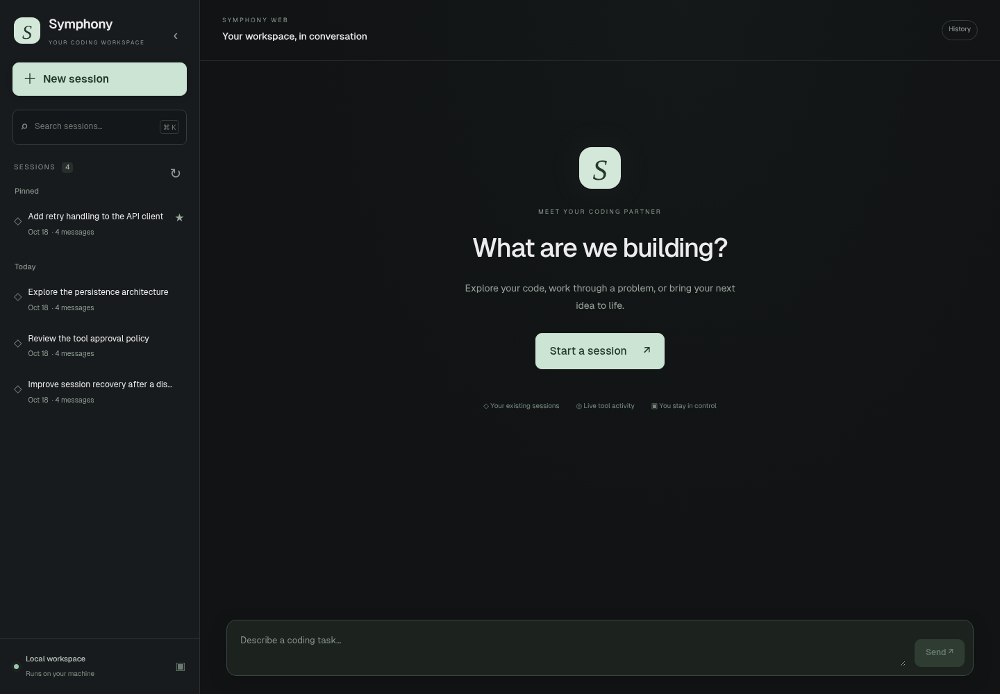
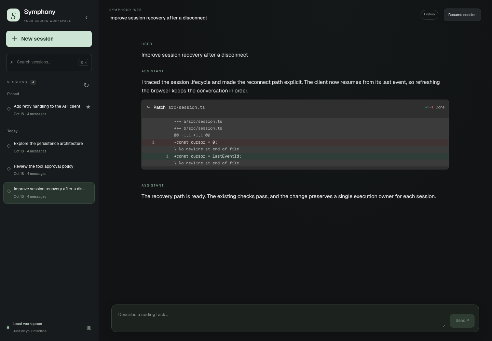
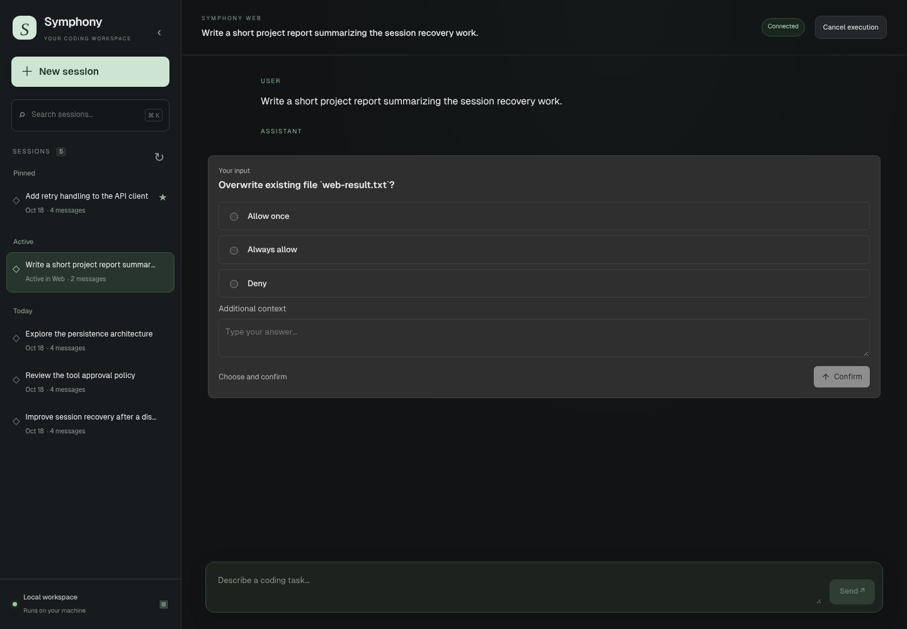
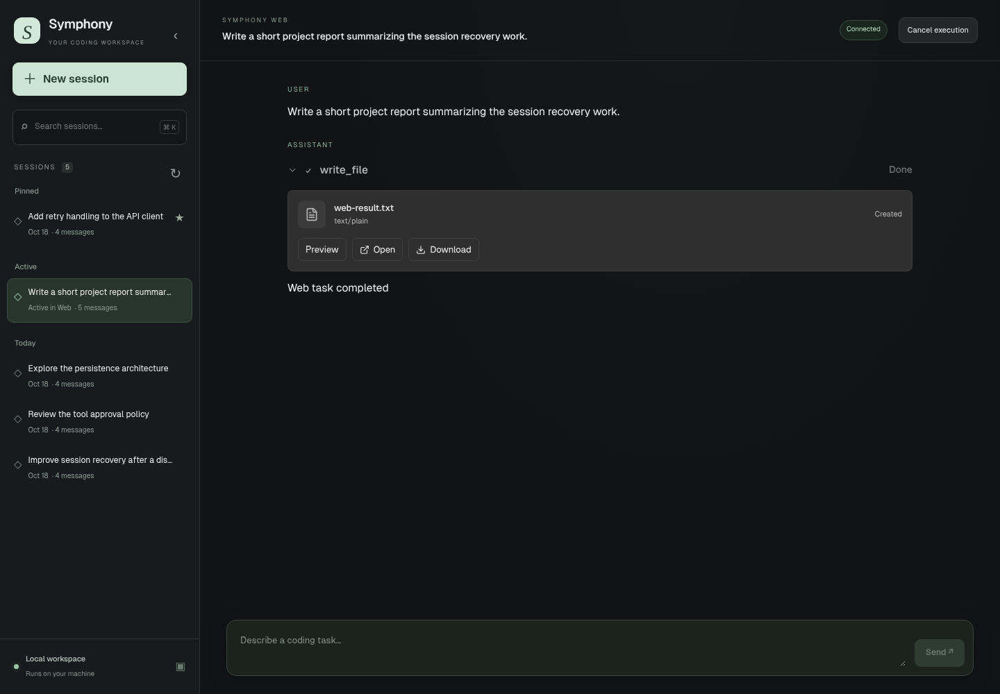
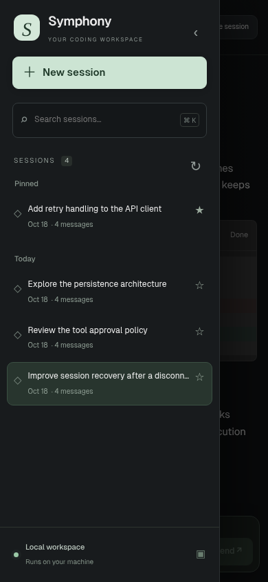

# Symphony Web

From a source checkout or an installed `symphony-code` wheel:

```sh
symphony web --workspace /path/to/project
symphony web --workspace /path/to/project --model local:my-model --port 8765
```

The command starts a Python standard-library HTTP server on `127.0.0.1`, chooses
an available port by default, and opens the system browser. `--no-browser` prints
the launch URL instead. Keep that URL private: its fragment is a per-launch
capability. The frontend saves it in tab-scoped session storage and removes it
from the address bar. End users need Python and their existing provider setup;
Node.js is only required to develop or rebuild the frontend.
`SYMPHONY_HOME` can relocate configuration, sessions and ownership records when
the default user home is read-only.

Select **New session** to start, or select a historical TUI session in the sidebar
and choose **Resume session**. Web uses the same `JsonlPersistence` transcript,
context, and checkpoint APIs and the same TUI session directory. Prompts execute
through the existing stdio protocol, `CodingAgent`, and `CoreHarness`. Existing
provider configuration, tools, approval policy, and deny rules apply. Questions
and approvals block until answered; cancellation uses the harness interrupt API.
The existing TUI UI and run loop are unchanged.

Each Web session has one worker process. Its lifetime session lock is shared
with TUI/headless registration, and the live registry also detects older running
TUI processes. A session owned elsewhere is readable but cannot be resumed.
Two browser tabs connect to the same worker; overlapping prompts return HTTP 409.
A browser refresh does not stop execution. Closing the server stops its workers;
restart Web and resume the persisted session to continue with a new prompt.
An interrupted turn is never silently rerun. Do not run older Symphony versions
that lack lifetime locks against the same session storage concurrently.

## Transport and security

Commands are JSON POST requests to `/api/sessions` (new) or
`/api/sessions/{id}/{resume,prompt,cancel,answer}`. Reads expose the session list,
historical messages/events/children, and `/api/sessions/{id}/events` SSE.
The SSE envelope has an increasing integer `id` and the existing stdio JSON frame
as `data`. `Last-Event-ID` replays missed frames. The frontend rejects gaps and
ignores duplicates. Its initial snapshot plus replay reconstructs pending
approvals and in-flight text after refresh. Replay is retained in server memory
for each worker's lifetime; restarting the server restores durable transcripts,
not token deltas. Reopen a session after worker recovery to start a fresh cursor.

The service has no remote-bind option. It checks exact Host, same-origin Origin
and Fetch Metadata, and a random capability on every API read/write. Mutations
require JSON. No CORS access is granted. Responses set CSP, no-referrer and
nosniff headers; URLs are not logged. Artifact downloads are restricted to files
observed in successful `write_file` events inside the selected workspace and
served as attachments. HTML and SVG are not embedded as active documents.
This protects against untrusted websites, not local processes or malicious
browser extensions that can read your launch capability. Agent tools run with
your user permissions; the browser UI does not add a filesystem sandbox.

## Frontend and wheel pipeline

`coding_agent/web-ui` is a React/Vite application using the published
`@sarchauhan/chat@0.0.1` components. Symphony event translation lives in
`src/events.ts`; the SDK has no Symphony-specific changes. It provides streaming
messages, tool outputs, patch diffs, approval questions, artifacts, and subagent
activity views. The Python host and compiled assets live in
`coding_agent/src/coding_agent/web` to fit the existing Python package layout.

```sh
uv sync --locked --all-packages --dev
cd coding_agent/web-ui
npm ci
npm test
npm run build
cd ../..
uv run --no-sync pytest coding_agent/tests/test_web.py
uv run --no-sync ruff check .
uv build --package symphony-code -o dist
# After installing the workspace wheels in an isolated virtual environment:
/path/to/venv/bin/python coding_agent/tests/web_wheel_smoke.py
```

Commit both frontend sources/lockfile and generated `web/static` assets. Python
wheel builds ship these assets without invoking npm. CI rebuilds and checks for
asset drift. The wheel can be installed and used on a machine without Node.
The browser integration test uses Playwright Chromium (system `chromium` when
available, otherwise `uv run playwright install chromium`); Chromium's sandbox
must be supported on the test host.

The published Chat package currently imports six helpers missing from its
published protocol dependency. `src/protocol-compat.ts` supplies backend-neutral
artifact/subagent envelopes and parsers plus usage/context parsers via a Vite
alias, re-exporting the installed protocol. The explicit protocol override and
lockfile make this reproducible. Remove this bridge when a compatible SDK is
published; do not patch `node_modules` or publish a fork as part of this feature.

HTTP/worker tests run a local OpenAI-compatible model stub through the real agent,
so no provider keys or live model requests are required. They cover history,
file-writing tasks, approvals, streaming replay, cancellation, ownership conflicts,
worker recovery and request security. The browser test covers the compiled UI,
questions, multiple turns and refresh. Live provider behavior depends on the
user's configured provider and is not exercised by these tests.

## Session navigation

The sidebar supports title/ID search, pinned sessions, active/today/recent/older
sections, message counts, and explicit TUI ownership indicators. Pinning, desktop
width, and collapse state are saved in this browser; they do not rewrite session
journals. Preferences are scoped to the browser origin; use a stable `--port`
to retain them across separate server launches. Use the resize handle or its arrow keys to adjust desktop width.
`Cmd/Ctrl K` focuses search, `Cmd/Ctrl B` toggles navigation, and arrow/Home/End
keys move between session buttons. On mobile, navigation becomes a modal drawer
with a backdrop, contained keyboard focus, Escape dismissal, and focus restoration.

## Screenshots

These are browser captures of the compiled frontend with seeded local history
and a local model stub, rather than live external provider responses.

Welcome and session navigation:



Historical conversation and a computed patch diff:



Interactive overwrite approval:



Created artifact after completion and browser refresh:



Mobile navigation:


